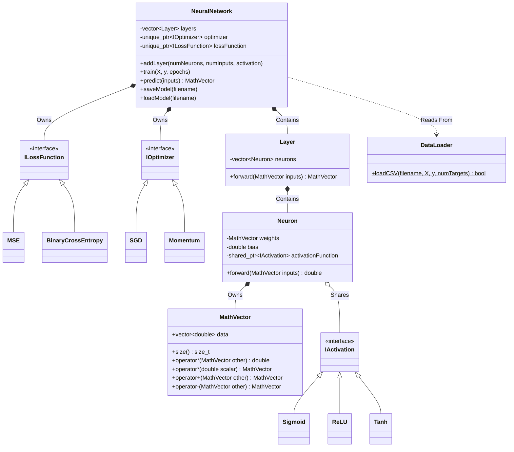

# MiniANN: Object-Oriented Artificial Neural Network in C++

## 1. Project Overview & Architecture
**MiniANN** is a lightweight, from-scratch artificial neural network library built entirely in modern C++17 without external machine learning dependencies. Its object-oriented design leverages polymorphism, RAII smart pointers (`std::unique_ptr`, `std::shared_ptr`), encapsulation, and operator overloading to provide a clean, modular, and extensible framework.

The design cleanly separates mathematical interfaces from network topology (`Neuron` and `Layer`), while `NeuralNetwork` orchestrates forward propagation, backpropagation, and model persistence.



---

## 2. Directory Structure

```text
Mini_ANN-CPP/
├── include/                  # Public C++17 header files (.hpp)
│   ├── Activations.hpp       # IActivation interface & Sigmoid, ReLU, Tanh
│   ├── DataLoader.hpp        # CSV dataset parser utility
│   ├── Layer.hpp             # Dense neural layer abstraction
│   ├── LossFunction.hpp      # ILossFunction interface & MSE, BinaryCrossEntropy
│   ├── MathVector.hpp        # Vector linear algebra operations
│   ├── NeuralNetwork.hpp     # Core network engine & persistence
│   ├── Neuron.hpp            # Single artificial neuron unit
│   └── Optimizer.hpp         # IOptimizer interface & SGD, Momentum
├── src/                      # Core library implementation (.cpp)
│   ├── DataLoader.cpp
│   ├── Layer.cpp
│   ├── NeuralNetwork.cpp
│   └── Neuron.cpp
├── examples/                 # Executable entry points (.cpp)
│   ├── main.cpp              # Flow A: CSV training & model saving pipeline
│   ├── predict_main.cpp      # Flow B: Saved model loading & inference pipeline
│   └── xor_main.cpp          # Flow C: Self-contained XOR verification demo
├── data/                     # Datasets & serialized models
│   └── data.csv              # Sample binary classification dataset
├── Makefile                  # Standard Make build configuration
├── CMakeLists.txt            # Modern CMake build configuration
└── README.md
```

---

## 3. Core Components

### 3.1 Linear Algebra Engine (`include/MathVector.hpp`)
Wraps `std::vector<double>` with checked operator overloads (`*` for dot product and scalar multiplication, `+` and `-` for element-wise operations, and `[]` indexing) to express forward and backward passes concisely.

### 3.2 Polymorphic Interfaces (`Activations.hpp`, `LossFunction.hpp`, `Optimizer.hpp`)
- **`IActivation`**: Defines `activate(double)` and `derivative(double)`. Implemented by `Sigmoid`, `ReLU`, and `Tanh`.
- **`ILossFunction`**: Defines `calculate(prediction, target)` and `derivative(prediction, target)`. Implemented by `MSE` and numerically clamped `BinaryCrossEntropy`.
- **`IOptimizer`**: Defines `calculateUpdate()` overloaded for weight vectors and scalar biases. Implemented by `SGD` and `Momentum`.

### 3.3 Network Topology (`Neuron.hpp` & `Layer.hpp`)
- **`Neuron`**: Encapsulates weights, bias, momentum velocities, and forward-pass caches (`last_inputs`, `last_z`, `last_a`) needed for backpropagation.
- **`Layer`**: Manages a contiguous `std::vector<Neuron>` and computes layer-wide forward activations.

### 3.4 Network Orchestrator (`NeuralNetwork.hpp`)
- **RAII Memory Safety**: Manages `IOptimizer` and `ILossFunction` via `std::unique_ptr` and layer activations via `std::shared_ptr` (while remaining backward-compatible with raw pointer construction).
- **Training & Inference**: Implements `predict()` for forward propagation and `train()` for backpropagation using the chain rule.
- **Persistence**: Serializes and deserializes trained weights and biases via `saveModel()` and `loadModel()`.

### 3.5 Data Pipeline (`DataLoader.hpp`)
Parses comma-separated numeric files into feature matrices (`X`) and target matrices (`y`).

---

## 4. Building & Running

### Option A: Using `make` (Recommended)
Build all executables (`bin/miniann`, `bin/predict_miniann`, `bin/xor_miniann`):
```bash
make
```

Run individual workflows directly:
```bash
make run-train      # Train on data/data.csv and save model weights
make run-predict    # Load saved model weights and run inference
make run-xor        # Train and evaluate on the classic XOR problem
```

Clean compiled binaries:
```bash
make clean
```

### Option B: Using CMake
```bash
cmake -B build
cmake --build build
./build/bin/miniann
./build/bin/predict_miniann
./build/bin/xor_miniann
```

### Option C: Direct `g++` Compilation
```bash
mkdir -p bin
g++ -std=c++17 -Wall -Wextra -O2 examples/main.cpp src/*.cpp -Iinclude -o bin/miniann
g++ -std=c++17 -Wall -Wextra -O2 examples/predict_main.cpp src/*.cpp -Iinclude -o bin/predict_miniann
g++ -std=c++17 -Wall -Wextra -O2 examples/xor_main.cpp src/*.cpp -Iinclude -o bin/xor_miniann
```
