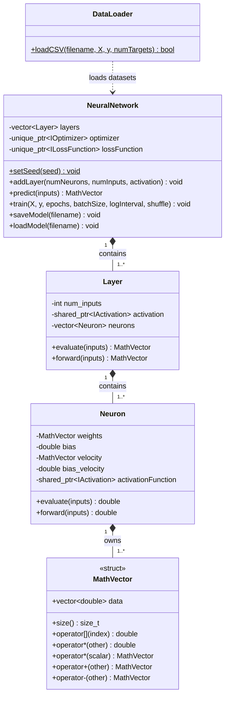
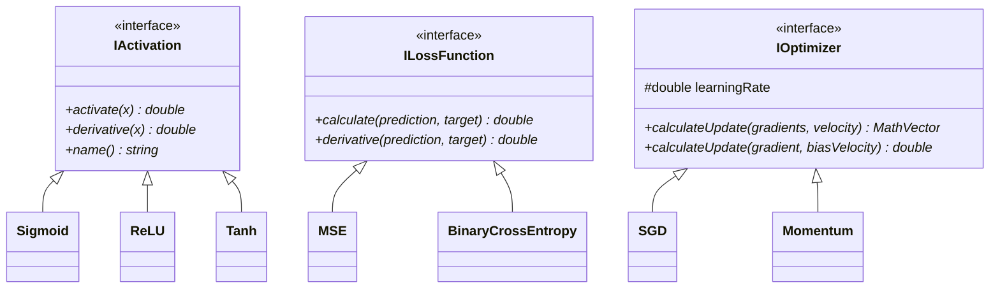

# MiniANN: Object-Oriented Artificial Neural Network in C++

## 1. Project Overview & Architecture
**MiniANN** is a lightweight, from-scratch artificial neural network library built in modern C++17 without external machine learning dependencies. Its object-oriented design leverages polymorphism, RAII smart pointers (`std::unique_ptr`, `std::shared_ptr`), encapsulation, and operator overloading to provide a clean, modular, and extensible framework.

The architecture cleanly separates mathematical interfaces (`IActivation`, `ILossFunction`, `IOptimizer`) from the physical network topology (`Neuron` and `Layer`), while `NeuralNetwork` orchestrates forward inference, mini-batch backpropagation, and full-precision model persistence.

### 1.1 Network Topology & Core Engine


### 1.2 Polymorphic Mathematical Interfaces


---

## 2. Directory Structure

```text
Mini_ANN-CPP/
├── include/                  # Public C++17 header files (.hpp)
│   ├── Activations.hpp       # IActivation interface & Sigmoid, ReLU, Tanh
│   ├── DataLoader.hpp        # Header-aware CSV dataset parser utility
│   ├── Layer.hpp             # Dense neural layer abstraction
│   ├── LossFunction.hpp      # ILossFunction interface & MSE, BinaryCrossEntropy
│   ├── MathVector.hpp        # Checked vector linear algebra operations
│   ├── NeuralNetwork.hpp     # Core network engine, training & persistence
│   ├── Neuron.hpp            # Artificial neuron with Xavier/He initialization
│   └── Optimizer.hpp         # IOptimizer interface & SGD, Momentum
├── src/                      # Core library implementation (.cpp)
│   ├── Activations.cpp
│   ├── DataLoader.cpp
│   ├── Layer.cpp
│   ├── LossFunction.cpp
│   ├── MathVector.cpp
│   ├── NeuralNetwork.cpp
│   ├── Neuron.cpp
│   └── Optimizer.cpp
├── examples/                 # Executable entry points (.cpp)
│   ├── main.cpp              # Flow A: CSV training & model saving pipeline
│   ├── predict_main.cpp      # Flow B: Saved model auto-loading & inference
│   └── xor_main.cpp          # Flow C: Self-contained XOR verification demo
├── tests/                    # Unit & numerical gradient verification suite
│   └── test_miniann.cpp
├── data/                     # Datasets & serialized models
│   └── data.csv              # 40-row binary classification dataset
├── Makefile                  # Incremental Make build & test configuration
├── CMakeLists.txt            # Modern CMake build & CTest configuration
└── README.md
```

---

## 3. Core Components & Highlights

- **Linear Algebra (`include/MathVector.hpp`)**: Checked operator overloads (`*`, `/`, `+`, `-`, `+=`, `-=`, `[]`) with dimension validation.
- **Weight Initialization & Reproducibility (`include/Neuron.hpp`)**: Uses **He normal initialization** for `ReLU` layers and **Xavier/Glorot uniform initialization** for `Tanh`/`Sigmoid` layers, with deterministic seeding via `NeuralNetwork::setSeed(seed)`.
- **Const-Correct Inference (`predict()`)**: `NeuralNetwork::predict()` and `Layer::evaluate()`/`Neuron::evaluate()` are strictly `const` and never mutate internal training caches.
- **Mini-Batch & Shuffled Training**: `NeuralNetwork::train()` validates input/target dimensions, shuffles training samples per epoch, supports arbitrary mini-batch sizes (`batchSize`), and allows configurable logging intervals (`logInterval`).
- **Full-Precision Self-Describing Persistence (`saveModel` / `loadModel`)**: Serializes layer sizes and activation types (`4,8:Tanh,4:Tanh,1:Sigmoid`) along with 17-digit (`max_digits10`) weights and biases. `loadModel()` can automatically reconstruct the network topology on an empty `NeuralNetwork` or strictly validate topology when loading into a pre-configured instance.
- **Resilient CSV Parser (`include/DataLoader.hpp`)**: Automatically detects and skips header rows, trims whitespace, and rejects malformed or inconsistent rows cleanly.

---

## 4. Building, Testing & Running

### Option A: Using `make` (Recommended)
Build all executables incrementally (with automatic `.d` header dependency tracking):
```bash
make
```

Run the unit and numerical gradient-check test suite:
```bash
make test
```

Run individual example workflows:
```bash
make run-train      # Train on data/data.csv and save model weights
make run-predict    # Auto-load saved model topology/weights and run inference
make run-xor        # Train and evaluate on the classic XOR problem
```

Clean compiled binaries and object files:
```bash
make clean
```

### Option B: Using CMake & CTest
```bash
cmake -B build
cmake --build build
ctest --test-dir build --output-on-failure
```
